# Lab 02: Ingest data with a pipeline

### Estimated Duration: 120 Minutes

## 📘 Scenario

As part of the same initiative, Contoso aims to **automate its data ingestion and transformation processes** to eliminate manual effort and improve efficiency. Using **Microsoft Fabric**, you will build a **Data Factory pipeline** that ingests data from external sources into the Lakehouse, transforms it using a Spark notebook, and integrates these steps into a unified workflow. This enables Contoso to establish a reliable, automated ETL process for delivering up-to-date data to business users.

## 📖 Overview

In this lab, you will learn how to use **Data Factory pipelines** in **Microsoft Fabric** to implement data ingestion solutions. You will create a pipeline that uses a Copy Data activity to copy data from an external source into your lakehouse, and then use a Spark notebook to transform the ingested data and load it into a table. Finally, you will modify the pipeline to include the notebook as part of the workflow.

## 🎯 Objectives

In this lab, you will complete the following tasks:

 - Task 1: Create a pipeline
 - Task 2: Create a notebook
 - Task 3: Modify the pipeline

## 🧩 Architecture Diagram


## Use Data Factory pipelines in Microsoft Fabric

A data lakehouse is a common analytical data store for cloud-scale analytics solutions. One of the core tasks of a data engineer is to implement and manage the ingestion of data from multiple operational data sources into the lakehouse. In Microsoft Fabric, you can implement *extract, transform, and load* (ETL) or *extract, load, and transform* (ELT) solutions for data ingestion through the creation of *pipelines*.

Fabric also supports Apache Spark, enabling you to write and run code to process data at scale. By combining the pipeline and Spark capabilities in Fabric, you can implement complex data ingestion logic that copies data from external sources into the OneLake storage on which the lakehouse is based, and then uses Spark code to perform custom data transformations before loading it into tables for analysis.

## Task 1: Create a pipeline

In this task, you will create a pipeline that ingests data from an external source into your lakehouse. You will use a Copy Data activity to copy the data, and then use a Spark notebook to transform the ingested data and load it into a table.

1. In the left navigation pane, select the workspace icon **dp_fabric-<inject key="DeploymentID" enableCopy="false"/> (1)** (below **Monitor**). In the pane that opens, select the workspace name **dp_fabric-<inject key="DeploymentID" enableCopy="false"/> (2)** at the top of the list to open the workspace page.

   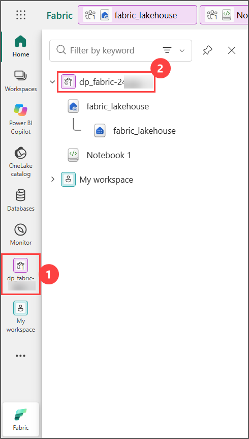

   > 📌**Note:** If a **Workspace page** tip appears next to the pane, select **X** to close it.

1. Select **+ New item (1)** in the top-left corner of the workspace. In the **New item** pane, type **Pipeline (2)** in the **Filter by keyword** box and then select the **Pipeline (3)** card.

   > 📌**Note:** If an **Add to favorites** tip appears, select **X** to close it.

   

1. On the New Pipeline window, enter the following details: 

   - Name: **Ingest Sales Data Pipeline (1)** 
   - Location: **dp_fabric-<inject key="DeploymentID" enableCopy="false"/> (2)**
   - Click on **Create (3)**
   
      
   
1. On the **Build a pipeline to organize and move your data** page, under **Start with guidance**, select the **Copy data assistant** card. This helps you quickly set up a data ingestion pipeline in Microsoft Fabric using a guided, low-code experience.

   

1. In the **Copy job** wizard, on the **Choose data source** page, type **http (1)** in the **Search** box and then select the **Http (2)** card under **New sources**.

   

1. In the **Connection settings** pane, enter the following settings for the connection to your data source:
    
   - URL: Enter the URL Below **(1)**
     ```
     https://raw.githubusercontent.com/MicrosoftLearning/dp-data/main/sales.csv
     ```
   - Connection: **Create new connection (2)**
   - Connection name: **Connection<inject key="DeploymentID" enableCopy="false"/> (3)**
   - Authentication kind: **Anonymous (4)**
   - Leave everything else as default
   - Click on **Next (5)**
  
     
    
1. On the **Choose data** pane, keep the default settings and click **Next**.
    
   
   
1. Wait a few seconds for the data to be sampled (the fields are greyed out while this happens), then verify the following settings:

   - **File format:** DelimitedText **(1)**
   - **Column delimiter:** Comma (,) **(2)**
   - **Row delimiter:** Default (\r,\n, or \r\n) **(3)**
   - Select **Preview data (4)** to view a sample of the data.
   - After reviewing, close the preview and select **Next (5)**.

     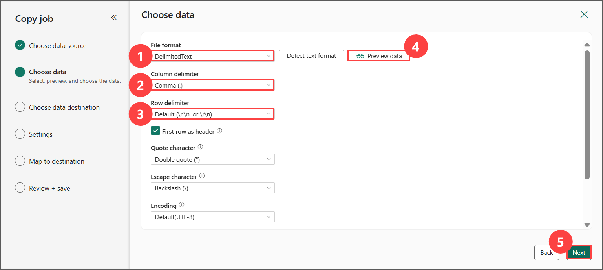

     > 📌**Note:** The default **Row delimiter** handles the line feed (\n) endings used in **sales.csv**, so you don't need to change it.

1. On the **Choose data destination** page, select the **OneLake catalog (1)** tab at the top, and then select the lakehouse **fabric_lakehouse (2)** from the list. This step ensures the ingested data is stored in your Lakehouse within Microsoft Fabric, making it available for further processing and analysis.
    
   

1. On the **Choose data destination** page, under **Connection settings**, leave **Connection (optional)** set to **(none) (1)** and select **Next (2)**.

   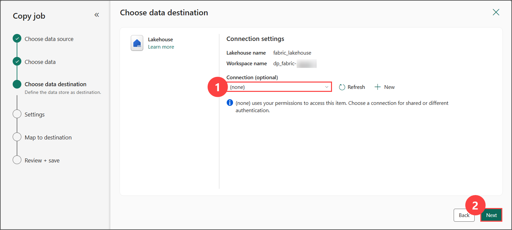

   > 📌**Note:** With **(none)**, the copy job uses your own permissions to write to the lakehouse.

1. On the **Settings** page, under **Read method**, keep **Full copy (1)** selected. Under **Destination root folder**, select **Files (2)**, and then select **Next (3)**.

   

1. On the **Map to destination** page, under **Data destination**, set **Folder path** to **new_data (1)** and **File name** to **sales.csv (2)**.
    
   

1. Scroll down, expand **File format settings**, and check the following file format options. Leave all other settings at their default values:

   - File format: **DelimitedText (1)**
   - Expand **File format settings (2)**
   - Column delimiter: **Comma (,) (3)**
   - Row delimiter: **Default (\r,\n, or \r\n) (4)**
   - Select **Next (5)** in the bottom-right corner.
   
     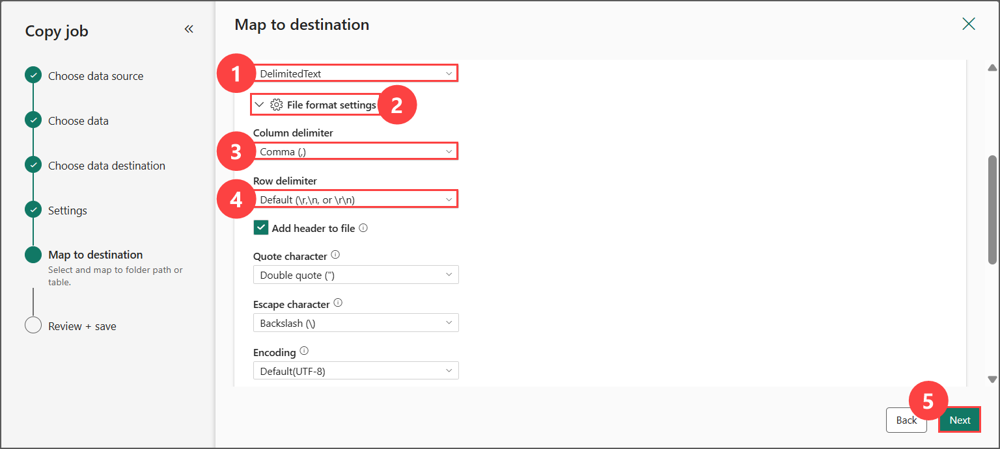

1. On the **Review + save** page, check that the **Source** is your HTTP connection and the **Destination** is **fabric_lakehouse** with **File name** `sales.csv` and **Folder path** `new_data`. Then select **Save** in the bottom-right corner.

   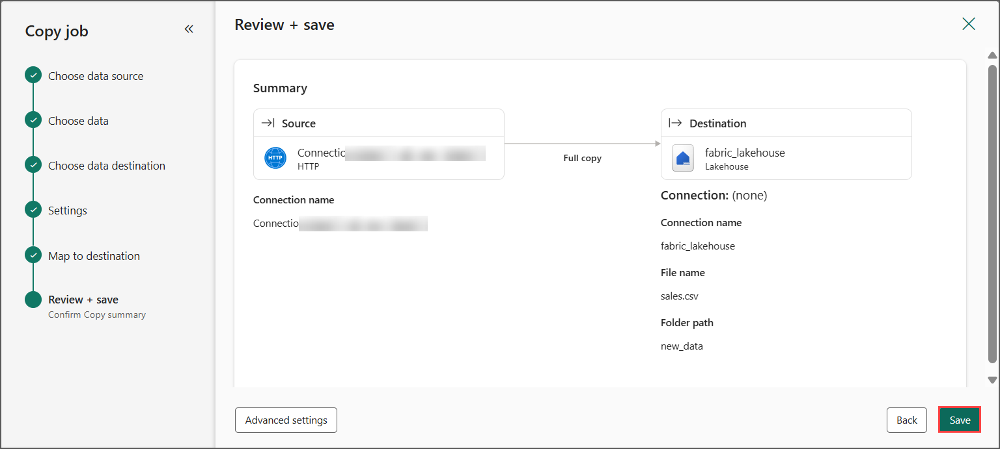

1. A **Create succeeded** notification appears, and the pipeline canvas now contains a **Copy job** activity, as shown here:

   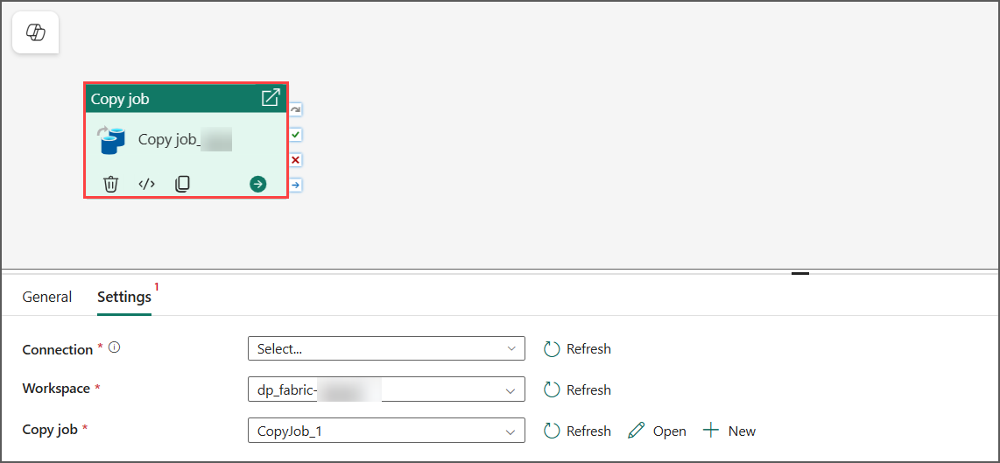

1. Click **Run** on the top menu to manually start the pipeline.

   

1. When prompted, click on **Save and run** to start the pipeline.

   

   > 📌**Note:** If you get an error `Copy job connection is required`, then perform the below-mentioned steps; otherwise, you can skip the below steps and proceed with **Step 25**.
   >
   > 

1. To set the connection, close the error pane. Then, with the **Copy job (1)** activity selected on the canvas, open the **Settings (2)** tab in the pane below the canvas. Select the **Connection** dropdown **(3)** and then select **Browse all (4)**.

   
    
1. On the **Get data** page, under **New sources**, select **Copy job**.

   
    
1. On the **Connect data source** page, under **Connection credentials**, set the following:

   - Connection name: **Connection<inject key="DeploymentID" enableCopy="false"/> (1)**
   - Leave **Authentication kind** as **Organizational account** and select **Sign in (2)**.

     
    
1. When prompted to sign in, select your **ODL_User** account or sign in manually using:
   - **Email/Username:** <inject key="AzureAdUserEmail"></inject>
   - **Temporary Access Pass:** <inject key="AzureAdUserPassword"></inject>

     
    
1. When the page shows **You are currently signed in (1)**, select **Connect (2)** in the bottom-right corner.

   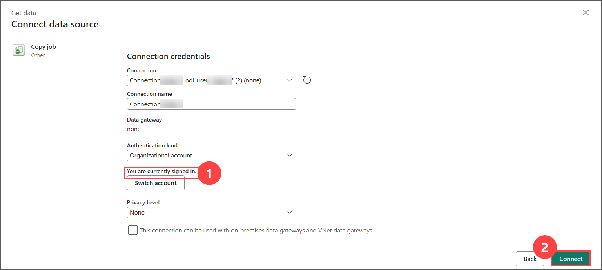
    
1. Back on the pipeline canvas, check that the **Connection** field now shows your connection. Then select **Run** on the **Home** tab of the ribbon.

   
    
1. In the **Save and run?** dialog, select **Save and run** to save and start the pipeline.

   

1. When the pipeline starts to run, the **Output** tab opens in the pane under the pipeline canvas. Select the **&#8635;** (*Refresh*) icon next to the **Pipeline run ID** to update the status, and wait until **Pipeline status** shows **Succeeded**. This takes about one minute.

   > 📌**Note:** If you don't see the **Output** tab, select **View run history** on the **Home** tab of the ribbon.

   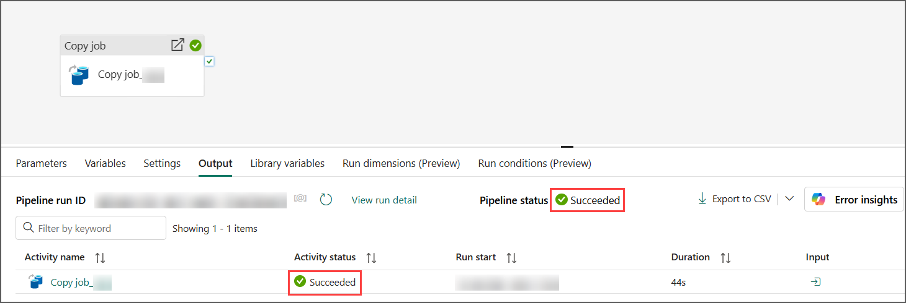

1. From the Top bar, navigate to your Lakehouse by clicking on the **fabric_lakehouse (1)**, expand **Files (2)** and select the **new_data (3)** folder, refresh the page, and verify that the **sales.csv (4)** file has been copied.

   

   >📌**Note:** You can also navigate to your Lakehouse by clicking your workspace and selecting the Lakehouse.

> **Congratulations** on completing the task! Now, it's time to validate it. Here are the steps:
> - Hit the Validate button for the corresponding task.
> - If you receive a success message, you can proceed to the next task.
> - If not, carefully read the error message and retry the step, following the instructions in the lab guide.
> - If you need any assistance, please contact us at cloudlabs-support@spektrasystems.com. We are available 24/7 to help you out.
<validation step="2abc605f-e05f-487d-9bd5-5016c4047d65" />

## Task 2: Create a notebook

In this task, you will create a Spark notebook to transform the ingested data and load it into a table. You will then run the notebook to verify that the data is correctly transformed and loaded.

1. Before you create a second notebook, stop the Spark session that is still running from Lab 01. The lab capacity runs a limited number of Spark sessions at a time; if the Lab 01 session is still active, the new notebook fails with a **TooManyRequestsForCapacity** error.

   - In the left navigation pane, select **Monitor**.
   - In the **Monitor** list, find the **Notebook 1** activity with the status **In progress (1)**. Hover over its name and select the **Cancel** icon (**⊘**) **(2)** that appears next to it.

     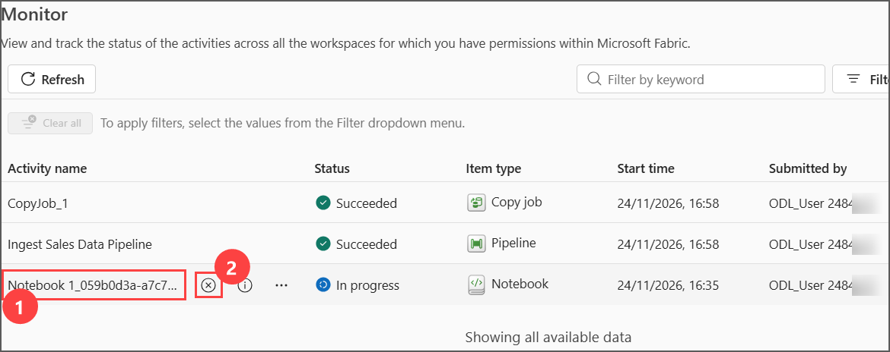

   - In the **Stop Apache Spark application?** dialog, select **Yes, stop**.

     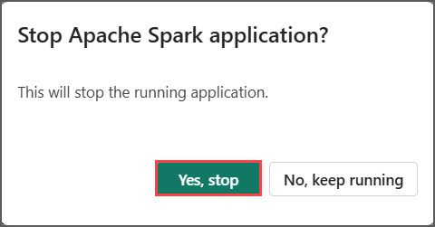

   > 📌**Note:** If **Notebook 1** is not listed as **In progress**, its session has already timed out, and you can continue to the next step.

1. Open your **fabric_lakehouse**. On the lakehouse **Home** tab, select **Analyze data with (1)** in the top-right corner, point to **Notebook (2)**, and then select **New notebook (3)**.

   

   After a few seconds, a new notebook containing a single *cell* will open. Notebooks are made up of one or more cells that can contain *code* or *markdown* (formatted text).

1. Select the existing cell in the notebook, which contains some simple code, and then replace the default code with the following variable declaration.

   ```python
   table_name = "sales"
   ```

1. Hover over the cell and select the **ellipsis (...) (1)** (**More commands**) in the cell toolbar at the top-right of the cell. In the menu, select **Toggle parameter cell (2)** to mark this cell as a parameter cell for pipeline runs. The cell then shows a **Parameters** label in its bottom-right corner. This allows the value to be dynamically passed from a pipeline during execution, enabling parameterized and reusable workflows in Microsoft Fabric.

   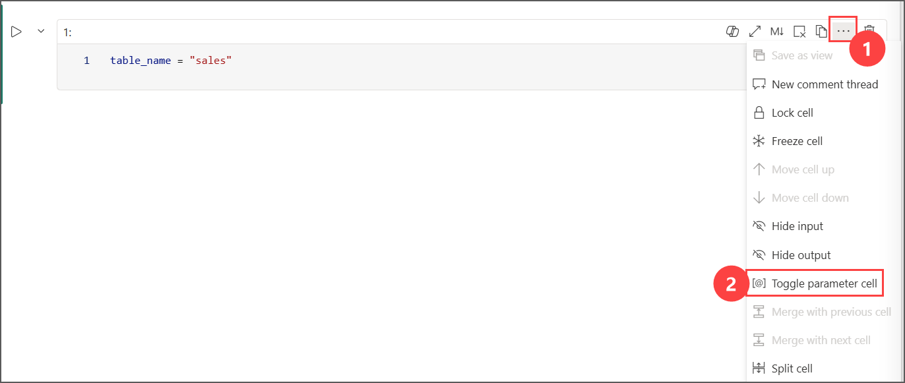

1. Hover just below the parameters cell and select **+ Add cell (1)** to insert a new code cell. Then paste the following transformation code into the new cell **(2)**, as shown in the screenshot. This code loads the data from the `sales.csv` file that was ingested by the **Copy Data** activity, applies some transformation logic, and saves the transformed data as a table - appending the data if the table already exists.

    ```python
   from pyspark.sql.functions import *

   # Read the new sales data
   df = spark.read.format("csv").option("header","true").load("Files/new_data/*.csv")

   ## Add month and year columns
   df = df.withColumn("Year", year(col("OrderDate"))).withColumn("Month", month(col("OrderDate")))

   # Derive FirstName and LastName columns
   df = df.withColumn("FirstName", split(col("CustomerName"), " ").getItem(0)).withColumn("LastName", split(col("CustomerName"), " ").getItem(1))

   # Filter and reorder columns
   df = df["SalesOrderNumber", "SalesOrderLineNumber", "OrderDate", "Year", "Month", "FirstName", "LastName", "EmailAddress", "Item", "Quantity", "UnitPrice", "TaxAmount"]

   # Load the data into a table
   df.write.format("delta").mode("append").saveAsTable(table_name)
    ```

    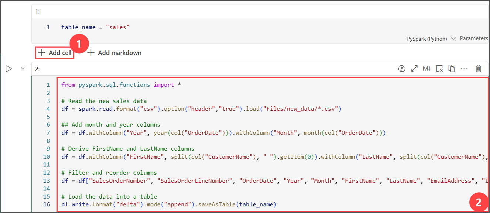

1. Verify that your notebook looks similar to this, and then select **&#9655; Run all** on the **Home** tab of the notebook toolbar to run all of its cells. The first run starts a Spark session and takes about a minute; wait until both cells show a green check mark.

    

    > 📌**Note:** If the run fails with **TooManyRequestsForCapacity**, the Lab 01 Spark session is still running. Complete step 1 of this task, wait a minute, and select **Run all** again.

1. After the notebook run completes, select the ⚙️ **Settings (1)** icon on the left of the notebook toolbar. In the pane that opens on the right, change **Name (2)** to **Load Sales**, select anywhere outside the box so the name is saved, and then close the pane with **X**.

    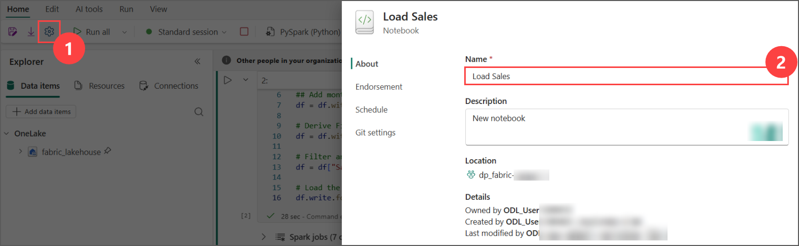

1. In the **Explorer** pane of your Lakehouse, from the ellipses menu **(1)** of Tables, click on **Refresh (2)**.  Then expand **Tables**, and select the **sales (3)** table to see a preview of the data it contains.

   

## Task 3: Modify the pipeline

In this task, you will modify the pipeline you created in Task 1 to include the notebook you created in Task 2. This will allow you to run the notebook as part of the pipeline workflow, enabling you to automate the data transformation and loading process.

1. In the bar of open items at the top of the page, select the **Ingest Sales Data Pipeline** tab you created previously.

    

1. Open the **Activities (1)** tab of the ribbon, select the **ellipsis (...) (2)** at the right end of the ribbon, and under **Move and transform** choose **Delete data (3)**. Drag the new **Delete data** activity to the left of the **Copy job** activity. Then select the **Delete data** activity, and drag its **On completion** handle (the blue **→** icon, the last of the four icons on its right edge) onto the **Copy job** activity to connect them.

    

    

1. Select the **Delete data** activity and, in the pane below the canvas, set **General (1)** → **Name (2)** to **Delete old files**.

    

1. In the **Source** section, configure the following:
    - **Connection**: Select the dropdown menu **(1)** and select **Browse all (2)**. On the **Choose a data source to get started** page, under **OneLake catalog**, select **fabric_lakehouse (3)**.  
    - **File path type (4)**: Wildcard file path  
    - **Folder path (5)**: Files/new_data
    - **Wildcard file name (6)**: *.csv  
    - **Recursively (7)**: Selected

        

        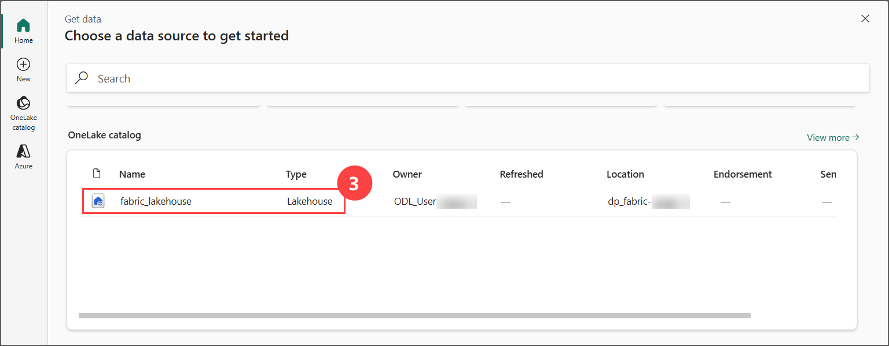

                        

1. Select the **Logging settings (1)** tab and clear the **Enable logging (2)** checkbox. It is selected by default; when it is cleared, the **Logging account connection** field disappears.

    

    >📌**Note:** These settings will ensure that any existing .csv files are deleted before copying the **sales.csv** file.

1. In the pipeline designer, from **Home (1)** tab select **Notebook (2)** on the top command bar to add a **Notebook** activity to the pipeline.

    

1. Drag the new **Notebook** activity to the right of the **Copy job** activity. Select the **Copy job** activity and drag its **On completion** handle (the blue **→** icon) onto the **Notebook** activity, as shown here:

    

1. Select the **Notebook** activity, and then in the pane below the design canvas, set the following properties:
    - **General**:
        - **Name**: Load Sales notebook

            
    
    - **Settings**:
        - **Notebook (1)**: Load Sales
        - Expand **Base parameters**. Fabric adds the **table_name** parameter automatically from the notebook's parameter cell, with **Type** **String** and **Value** **sales**. Change its **Value (2)** to **new_sales**:
            
            | Name | Type | Value |
            | -- | -- | -- |
            | table_name | String | new_sales |

            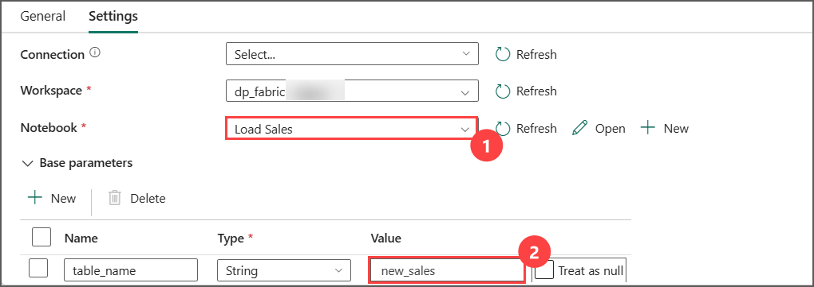

            > 📌**Note:** If **table_name** isn't listed, select **+ New** under **Base parameters** and add it with the values in the table.

    The **table_name** parameter will be passed to the notebook and override the default value assigned to the **table_name** variable in the parameters cell.

1. On the **Home (1)** tab, use the **&#128427;(2)** (*Save*) icon to save the pipeline. Then use the **&#9655; Run (3)** button to run the pipeline, and wait for all of the activities to complete.

    

    > **Note:** If the pipeline run is stuck in `In Progress` for 15-20 minutes, please navigate to the Monitor tab in the fabric portal from the left navigation pane, stop the Spark jobs, and then rerun the pipeline. 

1. Navigate to your **fabric_lakehouse** from the top navigation menu. 

    

1. In the **Explorer** pane, hover over **Tables**, select its **ellipsis (...)**, select **Refresh**, and then expand **Tables** and select the **new_sales** table to see a preview of the data it contains. This table was created by the notebook when it was run by the pipeline.

   

## 🧾 Summary

In this lab, you:

- Created a Data Factory pipeline in Microsoft Fabric to orchestrate data ingestion workflows.
- Used a Copy Data activity to ingest data from an external source into a Lakehouse.
- Built a Spark notebook to transform the ingested data and load it into a table.
- Integrated the notebook into the pipeline to automate transformation and loading steps end-to-end.
- Enhanced the pipeline to support a complete, automated data ingestion and processing workflow.

### 🎉 You have successfully completed the lab

By completing the **Work with Delta Lake and Data Factory pipelines in Microsoft Fabric** hands-on lab, you have gained practical experience in working with **Microsoft Fabric Lakehouses** and **Data Factory Pipelines** to manage and process data efficiently. You learned how to store and manage data using **Delta Lake tables**, enabling reliable, scalable, and versioned data processing through Apache Spark.

Additionally, you designed and implemented automated **ETL workflows using Fabric pipelines** to ingest, transform, and load data into your lakehouse. You also explored how to use Spark notebooks for data transformation and how to integrate them into your pipelines for end-to-end automation.

Overall, you have developed essential skills in leveraging Microsoft Fabric's capabilities for building robust data engineering solutions, enabling you to efficiently manage and analyze data in a modern data architecture.

